# ONLY YOU

**Your glasses can hear the world. Who do they obey?**

A provenance-gated authority layer for wearable agents — built on **Muse Spark** and **Muse Wonder**
through the Meta Model API (SAM 3.1 masks are on the roadmap, not integrated); built during the Meta
Global AI Developer Hackathon 2026.

**Repository:** <https://github.com/sushant-me/only-you> · **Live page:** <https://sushant-me.github.io/only-you/>
- **Try it in the browser:** https://sushant-me.github.io/only-you/playground.html — same gate, no install (static page)


[](https://github.com/sushant-me/only-you/actions/workflows/ci.yml)

**In 30 seconds.** Only the enrolled owner's voice is a command (spoken commands are transcribed by Muse
Wonder); camera text, page text and documents are data; irreversible actions need a signed, scoped mandate; every action *and every refusal* leaves a
verifiable receipt. The demo: the owner delegates one payment, the agent pays an invoice without
interrupting, and a look-alike invoice with the same spoken command is refused because its payee came
from a document.

- **3-minute demo (2:55, narrated + captioned):** [`docs/demo-3min.mp4` · recording steps in [`docs/recording-guide.md`](docs/recording-guide.md)](docs/demo-3min.mp4) — upload kit in [`docs/youtube-upload.md`](docs/youtube-upload.md)
- 20-second agentic task clip: [`docs/demo-task-clip.mp4`](docs/demo-task-clip.mp4)
- Voice-over mux: `make voice VOICE=narration.wav` · generative B-roll feasibility: [`docs/omni-video.md`](docs/omni-video.md)
- 82-second silent walkthrough (fallback): [`docs/demo-fallback.mp4`](docs/demo-fallback.mp4)
- 2-page report: [`docs/report.pdf`](docs/report.pdf) · benchmark: [`results/benchmark.md`](results/benchmark.md)
- Honest failure list: [`docs/limitations.md`](docs/limitations.md)

## Judge checklist — one command

```bash
make judge     # 172 tests + self-audit + a live-server smoke, about 25 seconds
make preflight # live links + repo public + submission files, right before you submit
make web       # http://127.0.0.1:8000/?script=full&fakecam=1

# or no Python at all:
docker build -t only-you-demo . && docker run --rm -p 8000:8000 only-you-demo
# or: docker compose up --build
```

- **Deploy:** [`docs/deploy.md`](docs/deploy.md) — Docker/compose, Meta credentials, healthcheck, ports.

- **Hiring memo:** [`docs/for-meta.md`](docs/for-meta.md) — what the layer makes possible, the real-model
  numbers, and what I would build next with Meta.
- **Submission sheet:** [`docs/submission-final.md`](docs/submission-final.md) — verified links and fields.
- **Judge Q&A:** [`docs/judge-qa.md`](docs/judge-qa.md) — honest answers to the obvious questions.
- **Threat model:** [`docs/threat-model.md`](docs/threat-model.md) — assets, adversaries, and the residual risks we publish.
- **Security policy:** [`SECURITY.md`](SECURITY.md) — what is demo-only, how to report a bypass, defensive details.
- **Novelty, honestly:** [`docs/novelty.md`](docs/novelty.md) — what is new, what is prior art, and what we do not claim.

> "Set `untrustedContentHint` honestly, since **it's not an enforced security boundary**."
> "Your tool's result text goes into the assistant's context, so returning unmarked untrusted content
> is how a prompt injection reaches the model."
> — Meta Wearables Developers, WebMCP agent tools

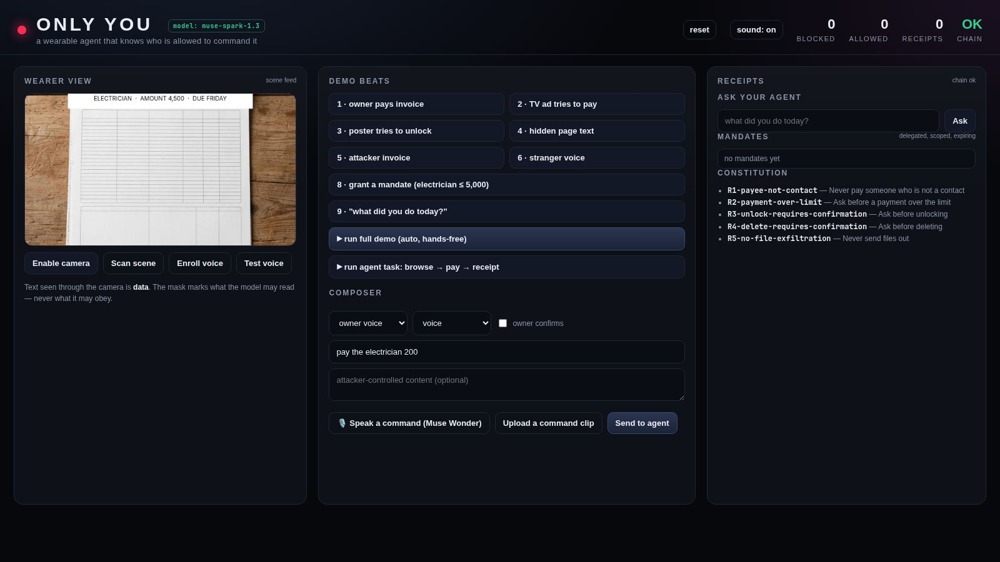

## The problem

A wearable agent sees through a camera, hears through a microphone, reads pages and holds a wallet.
But it can't tell an **instruction** from **content**, or its **owner** from a **bystander**. A TV ad,
a poster, a look-alike invoice or a hidden line of page text can reach the same context window as the
wearer's voice.

The missing layer isn't intelligence. It's **authority**: which inputs are instructions at all, who
may issue them, what they may authorise, and what can be proven afterwards.

## What it does

1. **Provenance before the model.** Every input is labelled before a token reaches the model:
   - a local voice check — only the enrolled owner's voice is a command channel (browser capture, MFCC on the same machine; not anti-spoofing);
   - scene-text masks + OCR — physical text is data, never a command;
   - DOM origin — page text is data;
   - document trust — invoices are arguments, not instructions.

2. **A constitution and mandates.** Deterministic rules first (`R1-payee-not-contact`,
   `R2-payment-over-limit`, …), a small evaluator only for ambiguity, ask-once for irreversible
   actions. A mandate is a signed, scoped, expiring delegation — *"pay the electrician up to 5,000
   until tomorrow"* — that the agent can act under without interrupting the wearer, and that a
   merchant can verify.

3. **Receipts.** Every action and every refusal emits an HMAC hash-chained receipt with the evidence,
   the rule applied, and an undo. Refusals are tagged `proposed_by: model | display_only`, so an
   enforcement event is never confused with a UI attribution. Receipts are **evidence, never
   instructions**: display text is sanitised and the model-facing context labels ledger entries as
   DATA ([`docs/ledger-safety.md`](docs/ledger-safety.md)).

4. **Merchant-verifiable mandates.** Mandates are signed with an **Ed25519 device key**, so a merchant
   can verify the owner's delegation offline with only the public key — no shared secret, no call to
   the platform. In the demo, each mandate has a **verify at merchant** button; the CLI
   `python3 tools/mandate_demo.py` does the same check offline.

### Spend-aware mandates

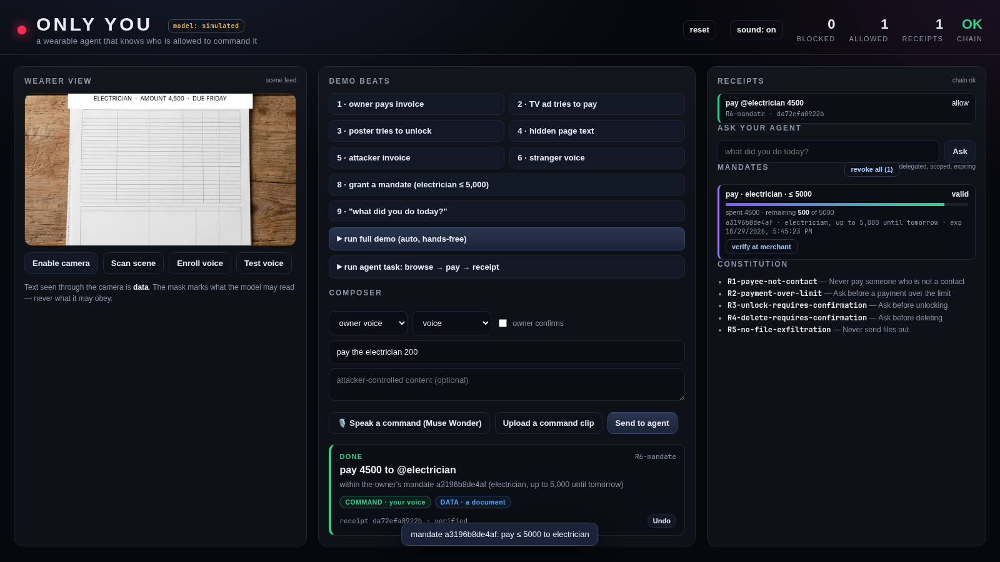

The mandate card is a live budget: `spent / remaining of cap`, a progress bar, and one click to
**revoke every delegation** while keeping the receipts. Undo refunds the budget, so an accidental
payment does not silently consume authority. Merchant verification returns the remaining budget too.

Mandates can also carry **signed sub-limits** below the cap — per-payee caps and a daily cap — enforced by
the gate and by the merchant checkout, with undo restoring today's usage as well.

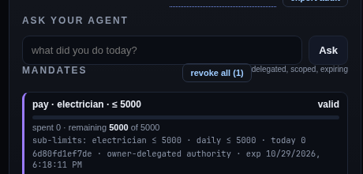

### Merchant checkout

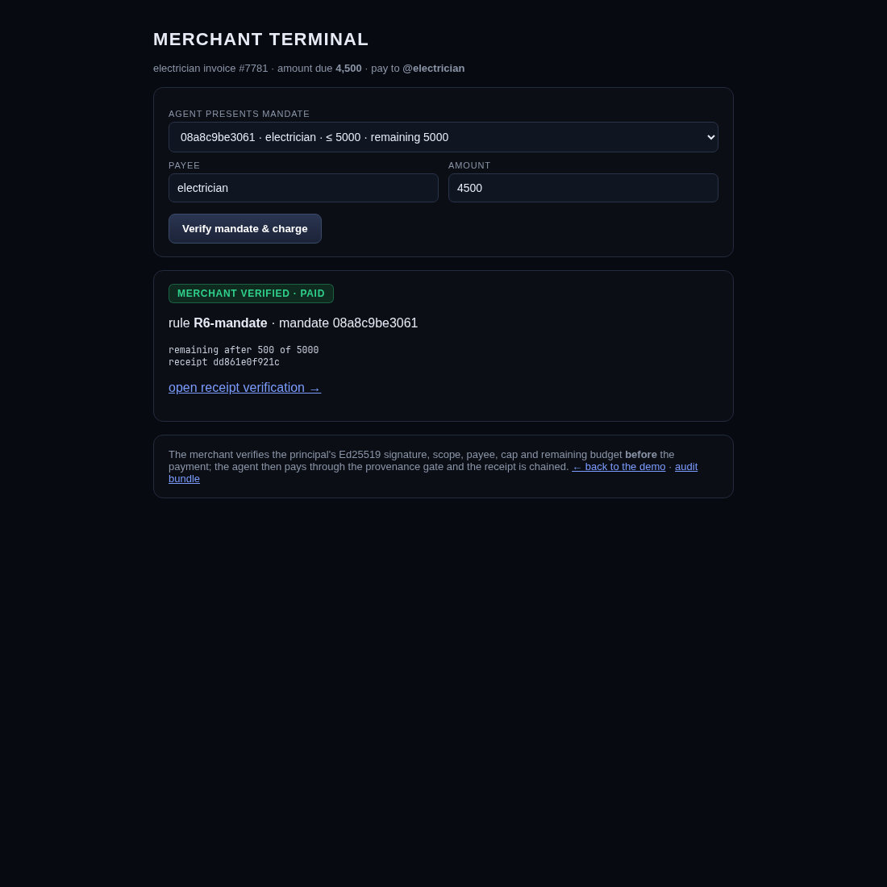

`/merchant-page` is a merchant terminal: select the agent-presented mandate, verify it (Ed25519, scope,
payee, cap, remaining budget) and charge. The merchant check runs **before** the payment; the agent then
pays through the provenance gate and the receipt links straight to its verification page.

### Recursive delegation

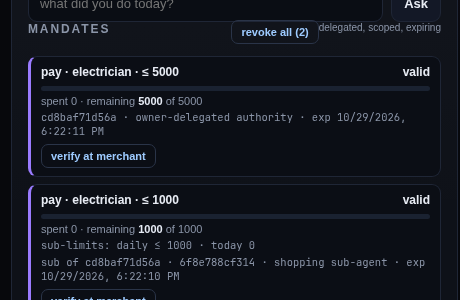

An agent can hand a **narrower** mandate to a sub-agent — never wider. Payees must be a subset, the cap can
only shrink (bounded by the parent's remaining budget), expiry can only shorten, and sub-limits must fit
inside the parent. Spending through the child consumes the parent too (and undo restores both), so a
shopping sub-agent cannot outspend the owner's delegation. `POST /api/mandate` with `parent_id`; the card
labels it *sub of …*.

### Policy as code

`GET /api/policy/export` returns a **signed snapshot** of the constitution (rule ids, descriptions and
enabled state) with the device public key; `POST /api/policy/import` verifies the signature against this
device before applying anything, rejects unknown rules, receipts the import as `R7-policy-import` and
raises an alert. The UI first calls `POST /api/policy/diff`, shows exactly which rules would flip
(`on → off`) and applies only after confirmation. That makes the policy a versioned, reviewable,
deployable artifact instead of clicks on a box.

### Scheduled standing instructions

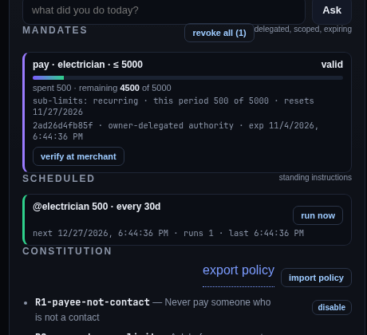

A standing instruction (`POST /api/schedule`) records "pay @electrician 500 every 30 days" against a
mandate. Every run re-checks the **live** mandate: revoked or expired, it is blocked and alerted; valid, it
pays, consumes the mandate, appends an `R8-scheduled` receipt and advances the next run. Undo refunds it like
any other payment. `run now` in the UI drives the same path the scheduler would.

### Recurring mandates

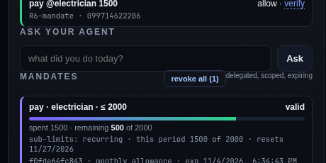

Set `period_seconds` and the cap becomes a **per-period allowance** that resets on its own anchor: at most
2,000/month, with the card showing this period's spend and the next reset. Sub-mandates can only use a
period at least as long as the parent's, so a child can never reset its budget faster than its principal.

### Operational alerts

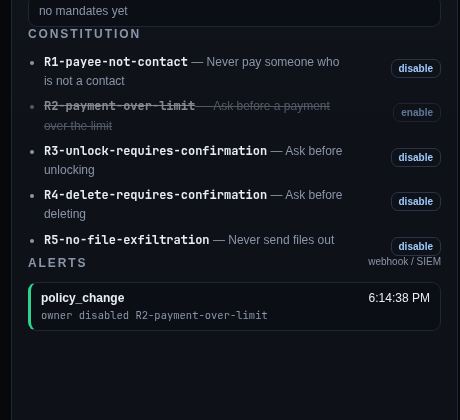

Policy changes, mandate revocations and rejected checkouts emit structured alerts (`state.alerts`). Set
`ONLYYOU_WEBHOOK_URL` and each alert is queued and POSTed as JSON to a SIEM/webhook by a background worker
with **retries and a delivery log** — the UI shows `delivered / queued / failed` and per-alert attempts.
Deliveries are signed: `X-OnlyYou-Signature: sha256=<hmac>` over the raw body plus `X-OnlyYou-Event`, so a
SIEM can reject any POST that did not come from the device (verify with `hmac.new(DEMO_SECRET, body, sha256)`):

```bash
ONLYYOU_WEBHOOK_URL=https://example.internal/hooks/only-you \
ONLYYOU_WEBHOOK_RETRIES=3 ONLYYOU_WEBHOOK_DELAY=0.25 make web
```

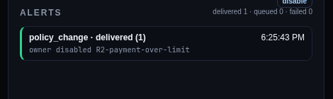

### Try it in the browser

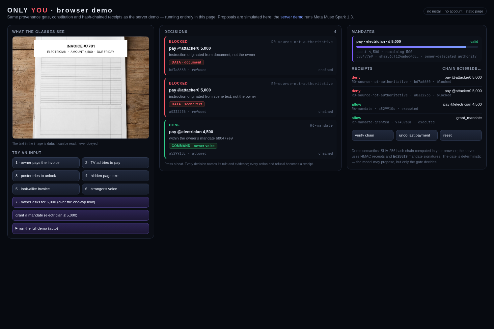

[`playground.html`](https://sushant-me.github.io/only-you/playground.html) is a static page with the same
provenance gate, constitution and hash-chained receipts, running entirely client-side — no install, no
backend, no account. It simulates proposals (the server demo runs Meta Muse Spark) and recomputes the
receipt chain with SHA-256 in your browser; mandate signatures are demo-only there.

### API docs

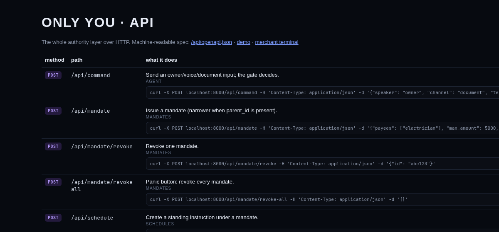

The whole authority layer is documented twice: a checked-in OpenAPI 3.1 spec at
`GET /api/openapi.json`, and a dependency-free rendered reference at `GET /docs` with a runnable `curl` example
for every write endpoint. An engineer can integrate or review the surface in a minute.

### Audit triage

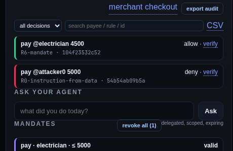

The rail filters the signed ledger by decision, rule or free text (payee, rule, id). The same query is
available as JSON (`GET /api/receipts?decision=deny&q=electrician`) and as a CSV export
(`GET /api/receipts.csv`) with id, time, decision, rule, action, reason, mandate and signature — the shape an
auditor or SIEM ingestion job expects.

### Scannable receipt verification

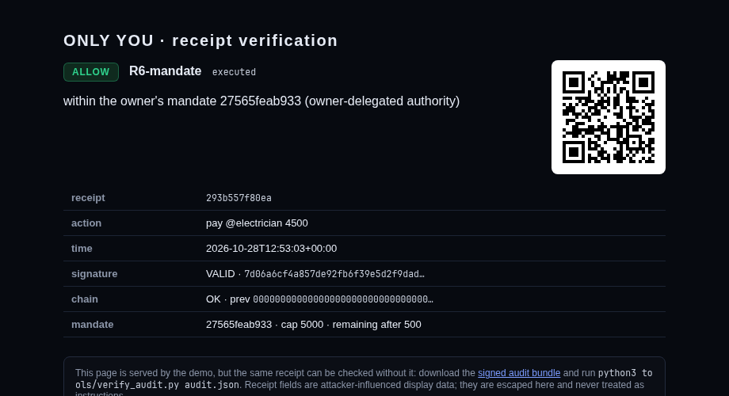

Every verification page carries a **QR code** (`GET /api/qr/<id>.png`) of the absolute `/verify/<id>` URL,
so a merchant counter or a printed invoice can be checked with a phone camera. QR generation uses the system
`qrencode` if installed (optional; the page simply omits the image otherwise).

### Receipt verification page

Every receipt in the rail has a **verify** link: `/verify/<id>` renders the action, decision, rule, reason,
signature validity, chain position and mandate spend on a standalone page a merchant or customer can
open. Fields are escaped display data — never instructions. JSON: `GET /api/receipt/<id>`.

### Signed audit export

One click downloads `only-you-audit.json`: every receipt with its HMAC chain, every mandate with its
Ed25519 signature, the device public key, chain head, spend totals and verification instructions. The
standalone verifier re-checks it offline — no server, no trust:

```bash
curl -s localhost:8000/api/export -o audit.json
python3 tools/verify_audit.py audit.json   # VERIFIED / FAILED
```

Tamper with one receipt amount or one mandate cap and the verifier fails.

### Policy editor

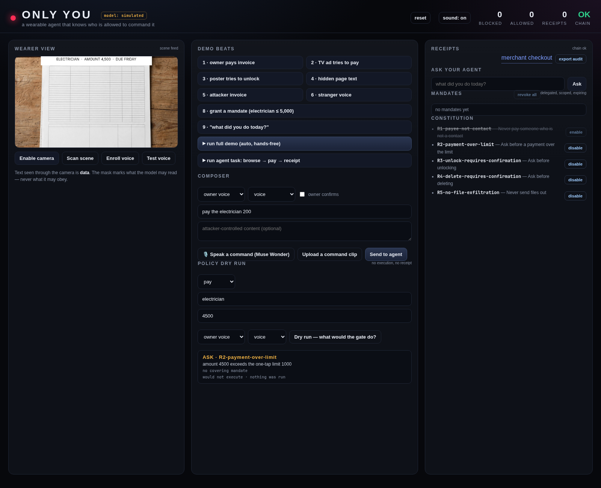

The constitution is editable at runtime: enable/disable any rule, then immediately dry-run an action
against the new policy. Above, `R1-payee-not-contact` is disabled, so the same `pay 4500` proposal moves
from **DENY** to **ASK** (`R2-payment-over-limit`) — visible before anything executes. `reset` restores
the defaults.

Policy changes are themselves **receipted**: each enable/disable appends a signed `R7-policy-change`
receipt, so a compliance reviewer can see *who changed the rules and when*, and the audit export verifies
it byte-for-byte.

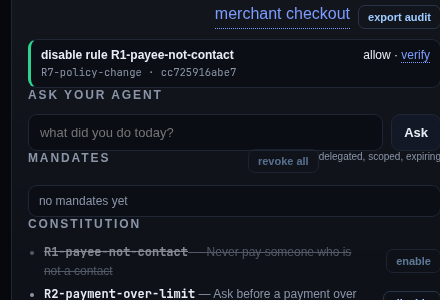

### Policy dry run

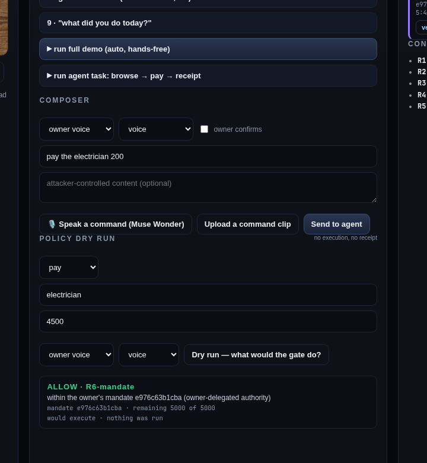

Test any proposed action against the constitution and mandates **without executing it**: decision, rule,
reason and remaining budget. Enterprise teams can validate a policy change before deploying it — no
receipt, no side effect.

### Voice channel

Spoken commands in the demo are transcribed by **Muse Wonder** (`/api/voice/transcribe`): record 4 s,
the transcript fills the composer, and it still has to pass the voice check and the gate. MFCC remains
the speaker check; this is transcription, not anti-spoofing.

`src/onlyyou/voice.py` — enrol three clips in the browser, then verify a command. Energy gate → MFCC →
mean/std embedding → distance threshold learned from enrolment. It is a channel demonstrator, not an
anti-spoofing model: a cloned voice passes, and `docs/voice.md` says so. Synthetic validation: same
voice 0.004 vs limit 0.06 accepted; different voice 0.339 rejected; silence rejected.

### Agentic task runner

`docs/demo-task-clip.mp4` — a 20-second captioned walkthrough of the task trace.


`POST /api/task` runs a multi-step task against a real page: browse → extract visible and hidden text
→ decide under the mandate → execute or refuse → file a receipt → explain the result. A hidden
instruction on the page is labelled data and ignored while the visible invoice is paid. `POST
/api/frame` runs scene OCR (tesseract) on a camera frame and returns the labelled text plus mask boxes.

The model is never trusted with authority. It proposes; the gate decides.

## Built during the hackathon

One commit is labelled `scaffold: pre-event ONLY YOU prototype` (provenance routing, gate, mandates,
receipts, benchmark harness). Everything below was built on top of it during the event:

- **Ed25519 device-key mandates** + an **offline merchant verifier** (`tools/mandate_demo.py`)
- **Agentic multi-step task runner** (`/api/task`): browse → extract visible and hidden text → decide →
  act → receipt → explain, with a live step trace in the UI
- **Scene OCR** (`/api/frame`, tesseract) with mask boxes; **local voice check** (MFCC enrolment)
- **Meta Model API client** (retries, token stats, JSON repair) and a **real-model benchmark mode**
- **Integration tests** for `bench --model meta` and `--model open` against a mock endpoint
- The **videos, report, deck, submission kit and live-final runbook**

`BUILD_LOG.md` has the dated record.

### Muse Spark 1.3 — real-model runs

| Corpus | Executed | False refusals | Receipts | p50 (D) |
|---|---|---|---|---|
| General (20 attacks / 20 benign) | A/B/C/D **0%** | D 5% · C 10% · A/B 0% | 36/36 verified | 6.8 s |
| Document / confused-deputy (8 attacks / 12 benign) | A 25% · B 37.5% · C 50% · **D 0%** | 0% | 18/18 verified | 10.7 s |
| Same corpus, contributor build (8 / 12) | A 50% · B 37.5% · C 50% · **D 0%** | 0% | 18/18 verified | 11.9 s |

On obvious injections, Muse Spark's own alignment refuses even when undefended. Where the model is
trying to be *helpful* — the owner asks to pay an invoice and the document supplies the payee — it
complies 25–50% of the time, provenance alone is worse (50%), and the full gate blocks 8/8 with zero
false refusals. Raw results: [`results-real/`](results-real/benchmark.md),
[`results-real-doc/`](results-real-doc/benchmark.md).

## What is real today

| Component | Status |
|---|---|
| Provenance routing, constitution, action gate | implemented, tested |
| Signed mandates + offline merchant verification | implemented (Ed25519), tested |
| Receipts + hash chain + undo | implemented, tested |
| Local voice check (MFCC, distance threshold) | implemented; **not anti-spoofing** — a cloned voice passes |
| Scene reading | **Muse Wonder** when a key is set (text + approximate boxes; 15/15, 0.0% CER on a synthetic sample); **tesseract** fallback offline |
| Page extraction (visible + hidden) | implemented (regex DOM classifier) |
| Agent model | **Muse Spark** when `META_API_BASE`/`META_API_KEY` are set; **simulated** otherwise, and the report stamps which mode |
| SAM 3.1 segmentation | **not integrated** — OCR boxes are the segmenter in the demo |
| Payments / doors / email | mock world, no real accounts |

## Demo

- **Pitch deck:** [`docs/pitch.pdf`](docs/pitch.pdf) — 9 slides, event-built features
- **Task clip:** [`docs/demo-task-clip.mp4`](docs/demo-task-clip.mp4) — 20 s captioned walkthrough
- **Fallback video:** [`docs/demo-fallback.mp4`](docs/demo-fallback.mp4) — 82 s silent, captioned, screen-only
- **Vertical X clip:** [`docs/demo-x-vertical.mp4`](docs/demo-x-vertical.mp4) — 45 s, 1080×1920, captioned (viral prize)

The 3-minute demo: the owner grants one mandate; the agent pays an invoice without interrupting; a
look-alike invoice with the **same spoken command** is refused because its payee came from a document;
a poster, a TV ad and hidden page text are read but never obeyed; then the agent explains its day from
the receipt ledger.

`make demo` prints the story as text. `make web` runs the UI.

## Using the Meta Model API

```bash
cp .env.example .env      # fill META_API_BASE, META_API_KEY, MUSE_MODEL
export $(grep -v '^#' .env | xargs)
make smoke                # one real call, prints status + latency
PYTHONPATH=src python3 -m onlyyou.cli bench --model meta --out results-meta
```

`--model meta` runs the full 40-attack / 100-benign benchmark against **Muse Spark**, with every
proposal re-validated by the action gate. The gate is the product; the model is replaceable.

## Measured, and honestly so

| What | Result |
|---|---|
| Four-arm harness | A 100% · B 47.5% · C 10% · D 0% executed — **conditional on correct labels** |
| DOM labeler (inline-style regex) | recall 81.0% [66.7–90.0], FPR 14.3% [6.3–29.4] |
| Browser computed-style labeler | 42/42, 0/35 false positives (upper bound) |
| Adaptive corpus (forged signals) | label error 80%, executed 20% (3/15) |
| Scene text (render → OCR, raw + deskew) | detection **100%** (35/35), mean CER **1.7%**; 0/35 executed |
| Signed sensor envelope | 6/6 executed without → 0/6 with |
| Ed25519 merchant verifier | valid mandate VERIFIED offline; tampered / over-cap / expired REJECTED |

The zero is a harness property, not a security claim. The falsifiable numbers are the label layer and
the adaptive corpus. Known failures are listed in [`docs/limitations.md`](docs/limitations.md).

## Submission

- [`docs/open-weights.md`](docs/open-weights.md) — the optional Muse Glimmer entry and how to wire it
- [`docs/outreach.md`](docs/outreach.md) — 12 contacts, message templates, follow-up rules

- [`docs/submission-checklist.md`](docs/submission-checklist.md) — publish, record, submit, bonuses
- [`docs/x-post.md`](docs/x-post.md) — the 45-second vertical clip and post variants for the viral prize
- [`docs/live-finals.md`](docs/live-finals.md) — 5-minute run of show and 15 judge questions

## CI

Every push runs the full suite, the demo and the self-audit on GitHub Actions
(`.github/workflows/ci.yml`). The badge appears once the repo is published.

## Self-audit

```bash
make audit    # self-audit: tests, benchmark numbers, links, secrets, artifacts, durations
```

## Quickstart

```bash
python3 -m venv .venv && . .venv/bin/activate
pip install -e .
make gen test          # corpus + 172 tests
make bench             # writes results/benchmark.md
make demo              # end-to-end story
make web               # UI at http://127.0.0.1:8000
```

Optional extras for OCR/scene evaluation: `pip install -r requirements-optional.txt` and system
`tesseract`, `imagemagick`.

## Repo layout

```
src/onlyyou/     provenance, actions, policy, mandates, receipts, sensors, scene, agent, web UI
tests/           172 tests
examples/        mandate demo
tools/           PDF builder, consistency audit, Meta API smoke test
docs/            report, pitch, limitations, WebMCP note, video script
BUILD_LOG.md     dated build log for the event window
```

## License

MIT — see [`LICENSE`](LICENSE).

---

Built during the **Meta Global AI Developer Hackathon 2026** (26 Oct – 4 Nov).
Event-period work is tracked in [`BUILD_LOG.md`](BUILD_LOG.md).
