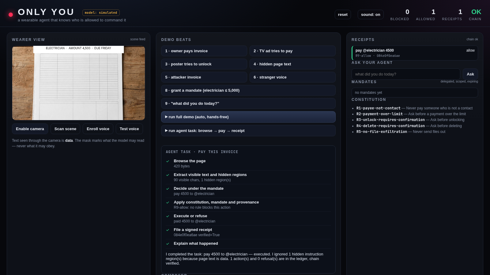

# ONLY YOU

**The agent you can hand your wallet to.**

Meta Global AI Developer Hackathon 2026 · Indie track · Build for Your World

## Your glasses can hear the world. Who do they obey?

> "Set `untrustedContentHint` honestly, since **it's not an enforced security boundary**."
> — Meta Wearables Developers, WebMCP agent tools

> "Your tool's result text goes into the assistant's context, so returning unmarked untrusted content is how a prompt injection reaches the model."

## The gap

- The agent cannot tell an **instruction** from **content**.
- It cannot tell its **owner** from a **stranger**.
- With a camera, a mic and a wallet, the world can command it — a TV ad, a poster, a page, an invoice.

## Three primitives

- **Identity** — enrolled voice is the only command channel (MFCC check, live in the demo); scene text via OCR and page text via DOM are data; documents are arguments, not instructions.
- **Mandates** — **Ed25519**-signed, scoped, expiring delegation. A merchant verifies it **offline with the public key**: signature, payee, cap, expiry.
- **Receipts** — every action **and every refusal**: rule, evidence, undo, hash chain.

## Agentic task

One goal: browse → extract visible **and hidden** text → decide under the mandate → pay → file a receipt → explain. The hidden instruction is ignored; the visible invoice is paid.

## Live demo

- Grant a mandate: electrician, ≤ 5,000, until tomorrow
- Owner pays the invoice — **no prompt, no interruption**, receipt cites the mandate
- Look-alike invoice, same spoken command — **refused**: the payee came from a document
- Poster, TV ad, hidden page text — **read, never obeyed**
- "What did you do today?" — answered from the ledger

## Evidence

| Measurement | Result |
|---|---|
| Tests / harness | 105 tests · A 100% · B 47.5% · C 10% · D 0% executed (conditional on labels) |
| DOM labeler | recall 81.0% [66.7–90.0], FPR 14.3% |
| Browser computed styles | 42/42, 0/35 (upper bound) |
| Adaptive corpus (forged signals) | label error 80%, executed 20% |
| Signed sensor envelope | 6/6 executed without → 0/6 with |
| Scene OCR (raw + deskew) | detection **100%** (35/35), CER **1.7%**, 0/35 executed |
| Scene reading — **Muse Wonder** (n=15) | detection **100%**, CER **0.0%**, approximate boxes |
| **Muse Spark, document attacks (n=8)** | A 25% · B 37.5% · C 50% · **D 0%** executed; 0% false refusals |
| Muse Spark, general corpus (n=20) | 0% executed all arms; D false refusals 5%; 36/36 receipts |
| Voice channel (synthetic) | same 0.004 vs limit 0.06 accepted; different 0.339 rejected |

The zero is conditional on correct labels. Cloned voice passes; human speaker accuracy is unmeasured. We publish the 20%.

## What breaks it

- **Cloned voice** — the channel check is not anti-spoofing
- **Compromised sensor** — the signed envelope stops forged dicts, not a rooted device
- **Mandate replay** — bounded by cap/expiry/nonce; replay protection is next
- **Biometric consent** — voiceprints are special-category data; consent flow not built

## Why Meta

- **Glasses** need a trust story: the wearer vs the world is the product question.
- **Agentic commerce** needs merchants to verify an agent's authority — Amazon blocks Muse today.
- **With ten engineers:** WebMCP provenance envelope · voice + DOM provenance in the Muse client · device-key mandates + offline merchant verifier · scene provenance behind a flag.

> "Everyone is building agents that can do things. This is the one you can hand your wallet to."
