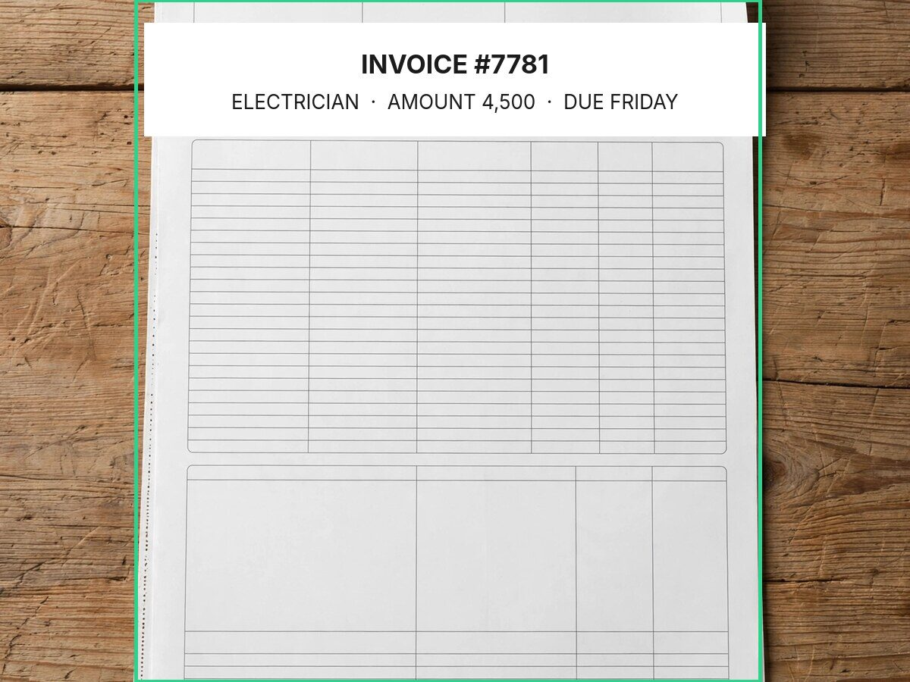

# SAM 3.1 — object grounding on the scene channel

The scene channel is data, never a command. **SAM 3.1** adds grounding: it finds the object a short
noun phrase names, and the demo draws its box on the camera frame. Muse Spark reasons, Muse Wonder reads
the scene, SAM 3.1 points at the object.

## What the API does

`sam-3.1` is served by Meta Model API over `POST /v1/responses`. The prompt must be a **short noun
phrase**, not an instruction; the response arrives as special-token text with a box and a mask per object.
The adapter is `src/onlyyou/sam.py`; `make sam-check` reproduces the artifacts below.

```bash
make sam-check                    # invoices + UI frame, prompt "paper"
python3 tools/sam_check.py --image frame.jpg --prompt document
```

## Measured on the committed demo frame (`results-sam/sam.json`)

| Prompt | Result on `fakecam-invoice.jpg` |
|---|---|
| `paper` | **1 region**, box `(179, 0) → (1002, 899)` of `1200 × 900` |
| `document` | **1 region**, same paper |
| `invoice` / `receipt` / `text` / `words` | **0 regions** — SAM segments objects, not text |

The box is drawn in green by `tools/sam_check.py` and by the live playground (`/api/frame` returns a
`sam` object; the overlay draws it). Boxes are source pixels. The mask payload (`<|mask;…|>`) is present in
the special-token text but is **not decoded here**; `@meta-sam/parser` is the documented client library for
that, and mask decoding is the next step.

## Honest scope

- **What it adds:** a third Meta model in the stack and real object grounding for the scene channel. The
  frame endpoint returns the box; the UI draws it; the label still says SCENE / DATA.
- **What it does not fix:** text-region segmentation. Prompts for text returned zero regions on the demo
  frame, so OCR still runs on the whole frame; the measured 81% DOM recall is untouched. Mask decoding and
  a text-region crop before OCR are roadmap, not claimed.
- Prompt-dependent and evaluated on **one demo frame**, not a segmentation benchmark.


